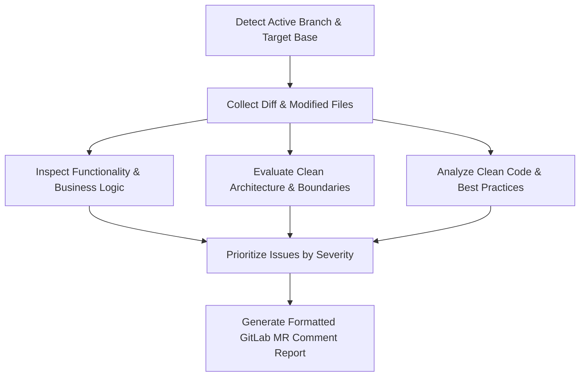

# Code Review Command (`/code-review`)

Perform an automated, in-depth code review on the active Git branch against its base/target branch. Evaluate **Functionality**, **Clean Architecture**, and **Clean Code**, and generate a structured, production-ready report in **Persian (فارسی)** intended to be posted directly as a **GitLab Merge Request comment**.

## Arguments & Execution
- **Arguments:** `$ARGUMENTS` (or `$1`): Target base branch (optional, e.g. `develop`, `master`, `release/1.0`). If omitted, default to `develop` (or `origin/develop`), or `master` (or `origin/master`) for release/hotfix branches.
- Parse `$ARGUMENTS` to determine the target base branch, immediately inspect the current branch changes against that base, and execute the review workflow below without asking unnecessary questions.

---

## 1. Review Methodology & Inspection Workflow



### Step 1.1: Determine Scope & Diff
1. **Identify the current branch:**
   Run `git branch --show-current`.
2. **Identify target base branch:**
   - Use `$ARGUMENTS` or `$1` if provided by the user.
   - Otherwise, default to:
     - **`develop` (or `origin/develop`):** Default target for all feature, bugfix, and development branches.
     - **`master` (or `origin/master`):** Stable/production branch (used for release/hotfix merges).
     - *(Note: There is no `main` branch in this workflow).*
   Determine the diff range against the target base (typically `origin/develop`):
   ```bash
   git diff --name-status origin/develop...HEAD
   ```
3. **Inspect the actual changes:**
   Read full changed files rather than just diff lines when understanding context, caller dependencies, and module structure is required.

### Step 1.2: Scoping Rule — Strict Diff Focus (محدوده بررسی و تمرکز دقیق بر تغییرات MR)
1. **فقط خطوط تغییریافته (Diff-Only Review):**
   نقدها، ایرادات و پیشنهادهای Clean Code باید **منحصراً** روی کدهای تغییریافته در این مرج‌ریکوئست (`git diff`) متمرکز باشند. **اکیداً ممنوع است** کدهای قدیمی و دست‌نخورده فایل که در این MR نقشی نداشته‌اند به عنوان ایراد، کامنت یا ترد ریویو مطرح شوند. این موارد در ریفکتورهای مجزا یا زمان توسعه همان بخش‌ها اصلاح می‌شوند و نباید روند مرج تسک فعلی را مسدود کنند.
2. **ارجاع به بخش‌های بیرونی فقط به عنوان ریشه معماری (Context & Root Cause Only):**
   تنها در صورتی مجاز به اشاره به کدهای خارج از Diff هستید که یک طراحی یا ساختار نامناسب در کدهای قبلی، مستقیماً **علت ریشه‌ای** بد نوشته شدن کدهای جدید این MR باشد. در این حالت نیز نباید برای کد قدیمی ترد مجزا ثبت شود، بلکه صرفاً به عنوان توضیح ریشه‌ای مسئله ارجاع داده شده و راه‌حل در ارتباط مستقیم با تغییرات جاری پیشنهاد می‌شود.

---

## 2. The 3 Review Pillars

### Pillar 1: Functionality & Correctness (صحت عملکردی)
Ensure the implementation performs exactly what it is designed to do without regressions, runtime exceptions, or logical flaws.
- **Business Logic & Edge Cases:**
  - Are boundary conditions handled (`null`, `undefined`, empty collections, zero/negative values)?
  - Are validation rules complete for all incoming data?
- **Async & Concurrency Safety:**
  - Are all asynchronous calls properly `await`ed?
  - Are race conditions, unhandled Promise rejections, or missing distributed locks (e.g., Redis locks) present in critical concurrent sections?
- **Error Handling & Resilience:**
  - Are error types semantic? Do `try/catch` blocks re-throw or handle errors properly without swallowing stack traces?
  - Are transaction rollbacks implemented for atomic operations (DB, external APIs)?
- **Test Verification:**
  - Are new features and bug fixes backed by automated unit or integration tests?
  - Do existing tests still pass, and do tests cover negative paths and edge cases?

### Pillar 2: Clean Architecture & Modular Boundaries (معماری تمیز)
Verify that architectural layer separations and dependency rules are strictly respected.
- **Dependency Inversion & Inward Dependencies:**
  - Dependencies must point inward toward business logic and domain entities.
  - Core layers must not depend on outer infrastructure frameworks.
- **Layer Separation:**
  - **Presentation Layer (Controllers/Routes/CLI):** Should only parse requests, validate input schemas, delegate to Application/BL layer, and format responses. Must NOT contain direct DB queries or business rules.
  - **Application / Business Logic Layer (`*Bl.js`, `*Service.js`):** Coordinates use cases and business rules. Must NOT leak transport objects (`req`, `res`, Express/Fastify context).
  - **Domain Layer:** Pure business entities and domain models, decoupled from database drivers or external APIs.
  - **Infrastructure Layer (`*Repository.js`, Adapters, Interfaces):** Implements data persistence, external service clients, message brokers.
- **Boundary Leaks to Flag:**
  - Direct database/ORM calls inside controllers.
  - Transport-layer objects passed into services or repositories.
  - Tight coupling between modules without dependency injection or interface abstraction.

### Pillar 3: Clean Code & Code Quality (کد تمیز و خوانایی)
Ensure the code is maintainable, self-documenting, and aligned with engineering conventions.
*(نکته حیاتی: تمامی بررسی‌های Clean Code صرفاً باید روی خطوط جدید یا ویرایش‌شده در این MR اعمال شوند و کدهای قدیمی دست‌نخورده فایل نباید کامنت شوند).*
- **Naming & Readability:**
  - Clear, intention-revealing names for variables, methods, and files.
  - No cryptic abbreviations or misleading identifiers.
- **Single Responsibility Principle (SRP):**
  - Functions should do one thing well.
  - Break down oversized functions (>30-40 lines) into small, focused helper methods.
- **Cognitive Complexity & Guard Clauses:**
  - Eliminate deep nested `if/else` structures using early returns / guard clauses.
- **DRY & KISS:**
  - Remove duplicated logic.
  - Avoid premature optimization and unnecessary abstraction layers.
- **Hygiene & Standards:**
  - No commented-out dead code, debugging `console.log`s, or unused imports.
  - Proper formatting and linting compliance.

---

## 3. Severity Classification

Every identified issue must be labeled with one of the following levels:
- 🔴 **[Critical / Blocker]**: Functional bugs, runtime exceptions, security holes, data loss risks, or major Clean Architecture layer violations that compromise the service. Must be resolved before merging.
- 🟡 **[Major]**: Unhandled edge cases, lack of test coverage for core logic, transport leaks into services, high cognitive complexity.
- 🔵 **[Minor / Clean Code]**: Naming improvements, code duplication (DRY), missing documentation/comments for complex logic, unused variables.
- 💡 **[Suggestion / Optimization]**: Performance optimizations, modern language idioms, minor refactoring recommendations.

---

## 4. Output Format: GitLab Merge Request Report (قالب گزارش فارسی)

گزارش نهایی ریویو باید به **زبان فارسی**، ساختاریافته و با لحن مهندسی دقیق تولید شود تا توسعه‌دهنده بتواند مستقیماً آن را در کامنت Merge Request گیت‌لب قرار دهد. قالب استاندارد خروجی:

```markdown
# 📋 گزارش بررسی کد (Merge Request Code Review Report)

### 📌 مشخصات بررسی
- **شاخه مبدأ (Source Branch):** `<active-branch>`
- **شاخه مقصد (Target Branch):** `<base-branch>`
- **فایل‌های تغییریافته:** `<count> فایل` (`+<added_lines>` / `-<removed_lines>`)
- **خلاصه تغییرات:** <خلاصه کوتاه و فنی از تغییرات و ارزیابی کیفی کلی>

---

### 🏛️ ارزیابی معماری و مرزبندی لایه‌ها (Clean Architecture)
- **تفکیک لایه‌ها (Layer Separation):** [✅ رعایت شده (Compliant) | ⚠️ دارای نقص (Violations Found)]
- **جریان وابستگی (Dependency Flow):** [✅ وابستگی رو به داخل (Inward) | ⚠️ نشتی به بیرون (Leaking Outward)]
- **توضیحات:** <شرح مختصر از نحوه قرارگیری کدهای جدید در معماری سرویس>

---

### 🚨 یافته‌ها و اقدامات اصلاحی (Findings & Actionable Fixes)

#### 🔴 ایرادات بحرانی (Blockers)
> *پیش از تایید و مرج باید رفع شوند.*

- **[صحت عملکردی | معماری تمیز] <عنوان ایراد>**
  - **محل:** `path/to/file.ext:LINE`
  - **شرح مشکل:** <توضیح شفاف باگ، ریسک یا نقص معماری>
  - **اقدام اصلاحی:**
  ```javascript
  // ❌ کد مشکل‌دار:
  ...
  // ✅ کد پیشنهادی:
  ...
  ```

#### 🟡 ایرادات با اولویت بالا (Major Issues)
> *نشتی معماری، مدیریت ناقص حالت‌های مرزی یا عدم پوشش تست.*

- **[دسته‌بندی] <عنوان ایراد>**
  - **محل:** `path/to/file.ext:LINE`
  - **شرح مشکل:** <توضیح مشکل>
  - **اقدام اصلاحی:** <راه‌حل پیشنهادی یا ریفکتور>

#### 🔵 بهبودهای کد تمیز (Clean Code & Readability)
> *خوانایی، نام‌گذاری، DRY و نگه‌داری‌پذیری.*

- `path/to/file.ext:LINE`: <نکته و پیشنهاد بهبود>

---

### 🧪 چک‌لیست صحت عملکرد و تست‌ها
- [ ] سناریوهای اصلی بیزینس بررسی و تایید شدند
- [ ] حالت‌های مرزی (null/خالی/خطاها) به درستی مدیریت شدند
- [ ] صحت async/await و تراکنش‌ها تضمین شد
- [ ] تست‌های خودکار برای منطق جدید اضافه یا به‌روزرسانی شدند
- [ ] مرزهای لایه‌های معماری تمیز حفظ شدند

---

### 🏁 نتیجه و پیشنهاد نهایی (Verdict)
- **وضعیت:** `REQUEST_CHANGES` | `APPROVED_WITH_COMMENTS` | `APPROVED`
- **گام‌های بعدی برای توسعه‌دهنده:**
  1. <اقدام مشخص>
  2. <اقدام مشخص>
```
