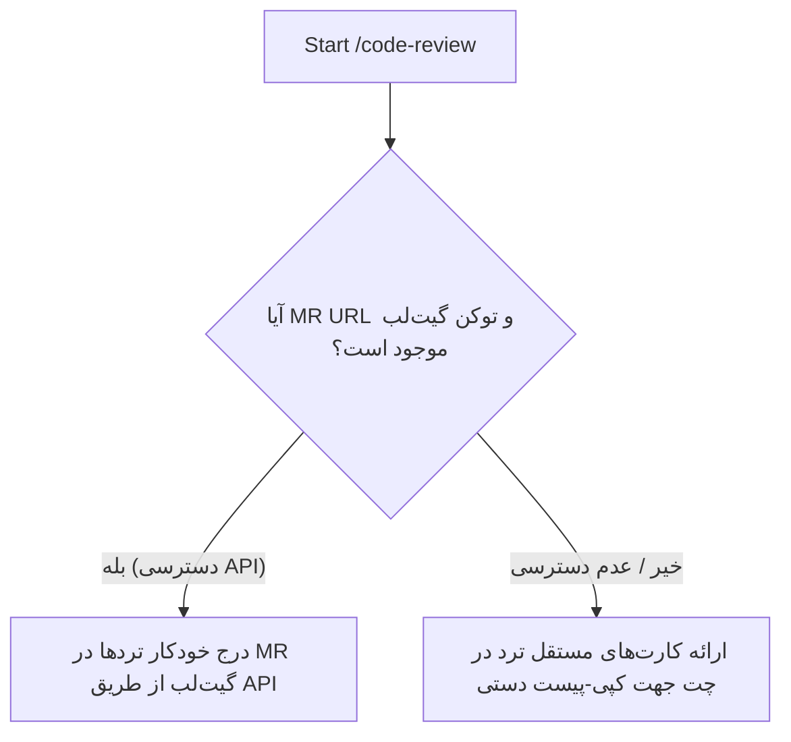
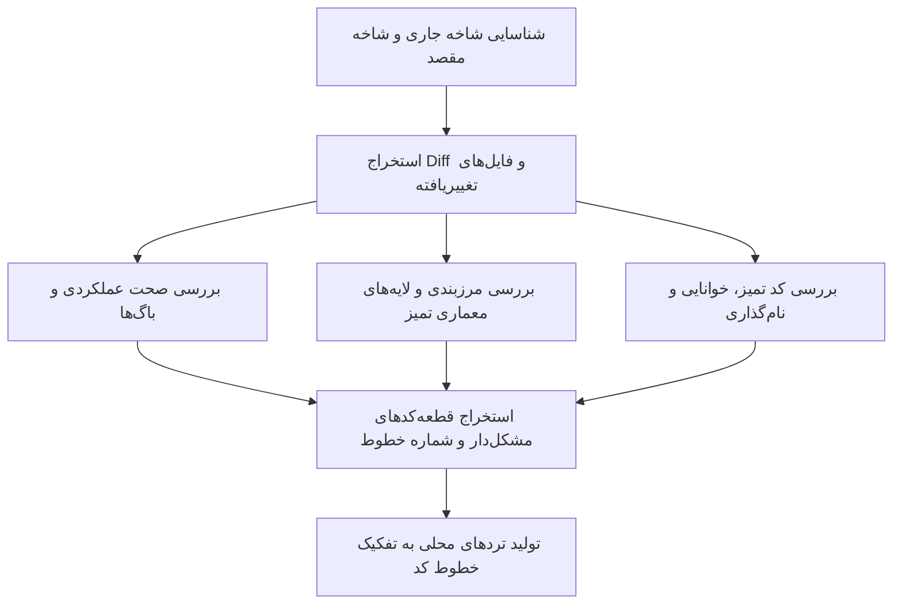

# Code Review Skill (`/code-review`)

Perform an automated, in-depth code review on the active Git branch against its base/target branch. Focus on **Functionality**, **Clean Architecture**, and **Clean Code**. Instead of outputting a single monolithic review comment, pinpoint the exact lines of code that contain issues and generate **dedicated, actionable discussion threads** for each finding.

---

## آرگومان‌ها و دو حالت اجرا (Arguments & Execution Modes)

### آرگومان‌ها (`$ARGUMENTS` یا ورودی کاربر):
- **نام شاخه مبنا (اختیاری):** مانند `develop` یا `master`. در صورت عدم ذکر، پیش‌فرض `develop` (یا `origin/develop`)، و برای شاخه‌های hotfix/release معادل `master` (یا `origin/master`) خواهد بود.
- **آدرس یا شناسه Merge Request گیت‌لب (اختیاری):** مانند `https://gitlab.example.com/group/project/-/merge_requests/42` یا `!42`.

### دو حالت اجرا (Dual Execution Modes):



1. **حالت اول: درج مستقیم تردها در گیت‌لب (Automated GitLab API Discussions):**
   - **شرط فعال‌سازی:** کاربر آدرس/شناسه MR را ارائه داده باشد و متغیر محیطی توکن (`GITLAB_TOKEN` یا `GL_TOKEN`) یا نشست لاگین `glab` در دسترس باشد.
   - **نحوه عملکرد:**
     1. از طریق API یا `glab` اطلاعات MR و مشخصات Diff Refs (`base_sha`, `start_sha`, `head_sha`) را استخراج کنید:
        ```bash
        # نمونه فراخوانی جزئیات MR
        curl --header "PRIVATE-TOKEN: $GITLAB_TOKEN" "$GITLAB_API_URL/projects/:id/merge_requests/:iid"
        ```
     2. برای هر ایراد یافت‌شده، یک ترد بحث مجزا (Discussion Thread) دقیقاً روی فایل و شماره خط تغییریافته با استفاده از GitLab Discussions API ایجاد کنید:
        ```bash
        curl --request POST \
          --header "PRIVATE-TOKEN: $GITLAB_TOKEN" \
          --header "Content-Type: application/json" \
          --data '{
            "body": "<متن فارسی ترد شامل برچسب شدت، شرح مسئله و کد پیشنهادی>",
            "position": {
              "base_sha": "<base_sha>",
              "start_sha": "<start_sha>",
              "head_sha": "<head_sha>",
              "position_type": "text",
              "new_path": "path/to/file.js",
              "new_line": 42
            }
          }' \
          "$GITLAB_API_URL/projects/:id/merge_requests/:iid/discussions"
        ```
     3. یک یادداشت کلی (General MR Note) حاوی خلاصه بررسی و وضعیت نهایی (Verdict) در صفحه اصلی MR ثبت کنید.
     4. گزارش وضعیت ثبت موفق تردها را به همراه لینک مستقیم به کاربر نمایش دهید.

2. **حالت دوم: کارت‌های ترد مجزا جهت کپی-پیست دستی (Manual Copy-Paste Thread Cards):**
   - **شرط فعال‌سازی:** در صورت عدم ارائه لینک MR یا نبود توکن دسترسی به گیت‌لب.
   - **نحوه عملکرد:** به جای تولید یک متن یکپارچه، هر ایراد را به عنوان یک **کارت ترد مجزا (GitLab Discussion Card)** با کدبلاک و موقعیت مشخص در چت قرار دهید تا کاربر بتواند در تب **Changes** گیت‌لب، روی همان خط کلیک کرده و متن ترد را پیست کند.

---

## 1. متدولوژی بررسی و بازرسی کد



### قانون حیاتی تمرکز بر Diff (محدوده دقیق بررسی):
1. **فقط خطوط تغییریافته (Diff-Only Review):**
   نقدها، ایرادات و پیشنهادهای Clean Code باید **منحصراً** روی کدهای تغییریافته در این مرج‌ریکوئست (`git diff`) متمرکز باشند. **اکیداً ممنوع است** کدهای قدیمی و دست‌نخورده فایل که در این MR نقشی نداشته‌اند به عنوان ایراد، کامنت یا ترد ریویو مطرح شوند. این موارد در ریفکتورهای مجزا یا زمان توسعه همان بخش‌ها اصلاح می‌شوند و نباید روند مرج تسک فعلی را مسدود کنند.
2. **ارجاع به بخش‌های بیرونی فقط به عنوان ریشه معماری (Context & Root Cause Only):**
   تنها در صورتی مجاز به اشاره به کدهای خارج از Diff هستید که یک طراحی یا ساختار نامناسب در کدهای قبلی، مستقیماً **علت ریشه‌ای** بد نوشته شدن کدهای جدید این MR باشد. در این حالت نیز نباید برای کد قدیمی ترد مجزا ثبت شود، بلکه صرفاً به عنوان توضیح ریشه‌ای مسئله ارجاع داده شده و راه‌حل در ارتباط مستقیم با تغییرات جاری پیشنهاد می‌شود.

---

## 2. ارکان سه‌گانه بررسی (The 3 Review Pillars)

### Pillar 1: Functionality & Correctness (صحت عملکردی)
- سناریوهای منطق کسب‌وکار، مقادیر مرزی (`null`, `undefined`, آرایه‌های خالی).
- اعتبارسنجی ورودی‌ها و جلوگیری از استثناهای زمان اجرا.
- ایمنی توابع ناهمگام (`await` کامل، عدم نشت Promiseهای مدیریت‌نشده، قفل‌های همزمانی).
- مدیریت خطا، عدم بلعیدن خطا در `catch`، و رول‌بک تراکنش‌ها در تراکنش‌های ناموفق.
- بررسی وجود تست‌های متناظر برای رفتارهای جدید.

### Pillar 2: Clean Architecture & Boundaries (معماری تمیز)
- **قانون جهت وابستگی‌ها:** وابستگی‌ها باید رو به داخل (به سمت Domain و Business Logic) باشند. لایه‌های درونی نباید به وب‌سرور یا جزئیات زیرساخت وابسته باشند.
- **تفکیک مسئولیت لایه‌ها:**
  - Controllers/Routes: صرفاً هدایت درخواست، اعتبارسنجی اسکیمای ورودی و فرمت خروجی (فاقد کوئری دیتابیس یا بیزینس رول).
  - Business/Service: منطق خالص بیزینس (عدم نشت شیء `req` / `res`).
  - Infrastructure/Repository: پیاده‌سازی کوئری‌ها، دیتابیس و ارتباطات شبکه.
- **عدم نشت آبجکت‌های انتقال (Transport Leakage):** عدم ارسال شیء درخواست وب یا کانتکست فریم‌ورک به سرویس‌ها یا ریپازیتوری‌ها.

### Pillar 3: Clean Code & Readability (کد تمیز و خوانایی)
*(فقط روی کدهای جدید یا تغییریافته)*
- نام‌گذاری گویا و هدفمند متغیرها و متدها.
- پایبندی به اصل تک‌مسئولیتی (SRP) و شکستن متدهای طولانی به هلپرهای مجزا.
- استفاده از Guard Clauses و Early Returns برای حذف شرط‌های تودرتو.
- رعایت DRY و KISS و حذف کدهای تکراری.
- پاکیزگی کد (حذف کامنت‌های مرده، `console.log`های دیباگ و ایمپورتهای استفاده‌نشده).

---

## 3. دسته‌بندی و اولویت‌بندی ایرادات (Severity)

هر ترد باید دقیقاً با یکی از برچسب‌های شدت زیر شروع شود:
- 🔴 **[Critical / Blocker]**: باگ‌های عملکردی، خطاهای زمان اجرا، رخنه‌های امنیتی، یا نقض‌های شدید معماری تمیز که پایداری سرویس را تهدید می‌کنند.
- 🟡 **[Major]**: عدم پوشش حالت‌های مرزی، نشت لایه‌ای (Transport Leak)، پیچیدگی شناختی بالا یا فقدان تست منطق حساس.
- 🔵 **[Minor / Clean Code]**: نام‌گذاری نامناسب، نقض DRY، توابع بیش از حد بلند، عدم استفاده از Guard Clause.
- 💡 **[Suggestion / Optimization]**: پیشنهادهای بهینه‌سازی کارایی، الگوهای مدرن زبان و ارتقای خوانایی.

---

## 4. ساختار استاندارد تردهای بحث (GitLab Discussion Thread Template)

هر ترد باید مختصر، دقیق و حاوی اصلاحیه ملموس باشد:

```markdown
**[🔴 بحرانی / 🟡 مهم / 🔵 کد تمیز / 💡 پیشنهاد] <عنوان کوتاه و واضح ایراد>**

- **شرح مسئله:** <توضیح کوتاه و فنی از مشکل یا ریسک در این خط کد>
- **اصلاحیه پیشنهادی:**
```javascript
// ❌ کد فعلی:
...
// ✅ کد پیشنهادی:
...
```
```

---

## 5. قالب خروجی نهایی در چت (Output Format)

اگر تردها مستقیماً از طریق API در گیت‌لب ثبت شدند، گزارش ثبت را به همراه لینک مستقیم ارائه دهید.
در غیر این صورت (حالت کپی-پیست)، خروجی باید به صورت زیر تولید شود:

### ۱. خلاصه ارزیابی و وضعیت کلی (Overview Summary)
```markdown
## 📋 خلاصه بررسی کد (Code Review Summary)
- **شاخه مبدأ:** `<source-branch>` ➔ **شاخه مقصد:** `<target-branch>`
- **فایل‌های بررسی‌شده:** `<count>` فایل
- **آمار یافته‌ها:** 🔴 `<count>` بحرانی | 🟡 `<count>` مهم | 🔵 `<count>` کد تمیز | 💡 `<count>` پیشنهاد
- **ارزیابی معماری:** [✅ رعایت کامل | ⚠️ دارای نقص در تفکیک لایه‌ها]
- **نتیجه نهایی:** `REQUEST_CHANGES` | `APPROVED_WITH_COMMENTS` | `APPROVED`
```

### ۲. تردهای خطی مجزا برای کپی در گیت‌لب (Copyable Discussion Cards)

برای هر ایراد، یک کارت مجزا شامل مسیر فایل، شماره خط و قطعه کد را به همراه متن آماده پیست نمایش دهید:

```markdown
---

### 🧵 ترد ۱: `src/services/orderService.js` (خط ۴۸)

**کد مربوطه:**
```javascript
const order = await this.repo.findById(orderId);
if (order.status === 'PAID') { ... }
```

**متن ترد (جهت درج کامنت روی خط ۴۸ در تب Changes):**
```markdown
**[🔴 بحرانی] عدم بررسی مقادیر null برای اردر یافت‌نشده**

- **شرح مسئله:** در صورتی که شناسه وارد شده در دیتابیس یافت نشود، متغیر `order` برابر `null` خواهد بود و ارجاع به `order.status` منجر به پرتاب خطای زمان اجرای `TypeError: Cannot read properties of null` می‌شود.
- **اصلاحیه پیشنهادی:**
```javascript
// ❌ کد فعلی:
const order = await this.repo.findById(orderId);
if (order.status === 'PAID') { ... }

// ✅ کد پیشنهادی:
const order = await this.repo.findById(orderId);
if (!order) {
  throw new NotFoundException(`سفارش با شناسه ${orderId} یافت نشد.`);
}
if (order.status === 'PAID') { ... }
```
```

---
```
*(به همین ترتیب برای سایر تردهای شناسایی‌شده ادامه می‌یابد).*
