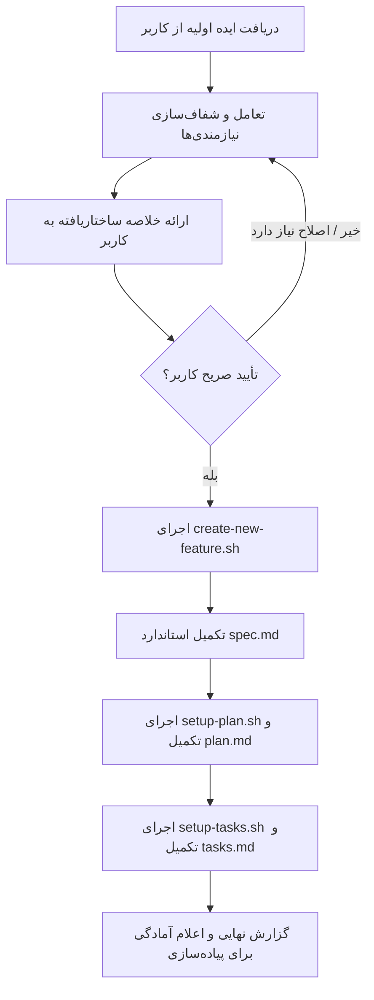

# GitHub Spec Kit Skill (`/spec-kit`)

اجرای فرایند کامل **Spec-Driven Development (SDD)** با استفاده از ابزار رسمی **GitHub Spec Kit (`specify` CLI)** جهت تبدیل ایده‌ها به مشخصات، پلن‌های معماری و تسک‌های اجرایی استاندارد، بدون نیاز به اجرای دستی و ترتیبی دستورات متوالی.

## آرگومان‌ها و نحوه اجرا (Arguments & Execution)
- **آرگومان‌ها / ورودی:** عنوان یا شرح اولیه ایده یا ویژگی مورد نظر کاربر (ارائه‌شده از طریق آرگومان اسلش‌کامند یا پیام چت).
- در صورت ارسال ورودی، بلافاصله آن را به عنوان ایده اولیه در نظر بگیرید و پیش‌نیازها و گام اول (شفاف‌سازی نیازمندی‌ها) را آغاز کنید. در صورت عدم ارسال ورودی، از کاربر به زبان فارسی بخواهید ایده یا فیچر مورد نظرش را بیان کند.

---

## ⚠️ قانون حیاتی: الزام وجود ابزار واقعی و عدم شبیه‌سازی (Mandatory Tool Execution)

> **اکیداً ممنوع:** ایجنت به هیچ عنوان نباید ساختار دایرکتوری‌ها، فایل‌های تمپلیت یا منطق برنچ‌بندی را خودش به صورت دستی یا شبیه‌سازی‌شده (Fake/Mock) بسازد.
> 
> **الزام:**
> - ابزار GitHub Spec Kit (`specify` CLI) **باید** روی سیستم کاربر نصب و در `PATH` در دسترس باشد.
> - عملیات ایجاد برنچ، آماده‌سازی تمپلیت‌ها و ثبت وضعیت ویژگی منحصراً باید از طریق اسکریپت‌های رسمی Spec Kit (`.specify/scripts/bash/`) اجرا شود.
> - اگر `specify` روی سیستم نصب نباشد، فرآیند بلافاصله باید متوقف شده و راهنمای نصب به کاربر ارائه شود.

---

## ۱. پیش‌نیازها و اعتبارسنجی محیط (Preflight Checks)

پیش از هر اقدامی، ایجنت باید مراحل زیر را بررسی و اجرا کند:

### ۱.۱. بررسی نصب بودن `specify` CLI
دستور زیر را بررسی کنید:
```bash
which specify && specify --version
```
- **اگر نصب نبود یا ارور داد:** فوراً متوقف شوید و به کاربر پیام دهید:
  > «ابزار GitHub Spec Kit (`specify` CLI) روی سیستم یافت نشد. لطفاً ابتدا با دستور زیر آن را نصب کنید:
  > ```bash
  > uv tool install specify-cli --from git+https://github.com/github/spec-kit.git
  > # یا با pipx:
  > # pipx install git+https://github.com/github/spec-kit.git
  > ```»

### ۱.۲. بررسی مقداردهی اولیه پروژه (Project Initialization)
بررسی کنید آیا دایرکتوری `.specify/` در ریشه پروژه وجود دارد یا خیر:
- **اگر `.specify/` وجود ندارد:** پروژه هنوز با Spec Kit آماده‌سازی نشده است. آن را با توجه به محیط ایجنت مقداردهی اولیه کنید:
  - **برای Google Antigravity:**
    ```bash
    specify init --here --force --ai agy
    ```
  - **برای Kilo Code:**
    ```bash
    specify init --here --force --integration kilocode
    ```
  - **برای سایر محیط‌ها (مانند Claude Code):**
    ```bash
    specify init --here --force --ai claude
    ```
  *(این دستور پوشه `.specify/`، تمپلیت‌های اصلی، اسکریپت‌های bash و قانون‌اساسی اولیه پروژه را می‌سازد).*

### ۱.۳. بررسی اسکریپت‌های سیستمی
اطمینان حاصل کنید اسکریپت‌های زیر در ریشه پروژه یا `.specify/scripts/bash/` وجود داشته و دسترسی اجرایی (`chmod +x`) دارند:
- `.specify/scripts/bash/create-new-feature.sh`
- `.specify/scripts/bash/setup-plan.sh`
- `.specify/scripts/bash/setup-tasks.sh`
- `.specify/scripts/bash/common.sh`

---

## ۲. گردش کار (Workflow)



---

## ۳. مراحل گام‌به‌گام

### گام اول: تعامل و شفاف‌سازی نیازمندی‌ها (Clarification & Alignment)

پس از دریافت ایده کاربر، **بلافاصله شروع به ساخت فایل نکنید**:

1. **ارتباط روان و تعاملی (به زبان فارسی):**
   پرسش‌های دقیق و فنی برای روشن شدن نقاط کور بپرسید:
   - **داستان‌های کاربری و سناریوها (What & Why):** دقیقاً چه سناریوهایی وجود دارند؟ رفتار سیستم در قبال کاربر چیست؟
   - **اولویت‌بندی (P1, P2, P3):** کدام بخش حداقل محصول قابل ارائه (MVP) است که به تنهایی ارزش تست و دمو دارد؟
   - **تکنولوژی و معماری (How):** استک فنی چیست؟ (فریم‌ورک، پایگاه‌داده، مدل ذخیره‌سازی، پکیج‌های خارجی).
   - **مرزهای سیستم (Scope Boundaries):** چه مواردی صراحتاً Out-of-Scope (خارج از محدوده تسک فعلی) هستند؟
   - **موارد حاشیه‌ای و لبه (Edge Cases):** در صورت خطا یا شرایط مرزی سیستم چه واکنشی نشان می‌دهد؟

2. **تدوین خلاصه نهایی (Proposal Summary):**
   یک خلاصه ساختاریافته به کاربر ارائه دهید شامل:
   - **نام کوتاه ویژگی (Short Name):** ۲ تا ۴ کلمه، مانند `auth-jwt-refresh` یا `media-upload-pipeline`.
   - **شرح داستان‌های کاربری (User Stories) و اولویت‌ها (P1, P2).**
   - **طرح معماری و استک فنی پیشنهادی.**
   - **ساختار کلی فایل‌ها در پروژه.**

3. **گیت تأیید صریح (User Approval Gate):**
   حتماً در پایان خلاصه از کاربر تأیید بخواهید:
   > «آیا با مشخصات و ساختار فوق برای ایجاد اسناد و تسک‌های GitHub Spec Kit موافقید تا فایل‌ها ساخته شوند؟»
   **هیچ فایلی نباید قبل از تأیید صریح کاربر ساخته شود.**

---

### گام دوم: اجرای ابزارهای واقعی Spec Kit (Execution via Real Tools)

پس از اخذ تأیید کاربر، با استفاده از ابزارهای رسمی مراحل زیر را دقیقاً اجرا کنید:

#### ۱. ایجاد برنچ و ساختار ویژگی (Feature Creation):
اسکریپت رسمی Spec Kit را فراخوانی کنید:
```bash
bash .specify/scripts/bash/create-new-feature.sh --json --short-name "<short-name>" "<feature description>"
```
خروجی JSON اسکریپت را دریافت کنید که شامل:
- `BRANCH_NAME`: نام برنچ گیت ایجاد شده (مثلاً `001-user-auth`).
- `FEATURE_DIR`: دایرکتوری ایجاد شده در `specs/` (مثلاً `specs/001-user-auth`).
- `SPEC_FILE`: مسیر فایل اسپک (مثلاً `specs/001-user-auth/spec.md`).

#### ۲. تکمیل فایل `spec.md`:
فایل ایجاد شده را طبق فرمت استاندارد `spec-template.md` و نتایج گفت‌وگو تکمیل کنید:
- **Header:** نام ویژگی، نام برنچ، تاریخ، وضعیت (`Draft` -> `Approved`).
- **User Scenarios & Testing:** داستان‌های کاربری اولویت‌بندی شده (P1 MVP, P2, P3) با فرمت دقیق Acceptance Scenarios:
  ```markdown
  ### User Story 1 - [عنوان] (Priority: P1)
  [شرح به زبان ساده]
  **Why this priority**: [دلیل اولویت]
  **Independent Test**: [نحوه تست مستقل]
  **Acceptance Scenarios**:
  1. **Given** [وضعیت اولیه], **When** [اقدام], **Then** [نتیجه مورد انتظار]
  ```
- **Edge Cases:** شرایط مرزی و سناریوهای خطا.
- **Functional Requirements:** نیازمندی‌های تابعی با شناسه‌های یکتا (`FR-001`, `FR-002`, ...).
- **Key Entities:** موجودیت‌های کلیدی داده‌ای.

#### ۳. آماده‌سازی و تکمیل فایل `plan.md`:
اسکریپت زیر را اجرا کنید تا تمپلیت پلن در پوشه ویژگی ایجاد شود:
```bash
bash .specify/scripts/bash/setup-plan.sh --json
```
سپس فایل `specs/<FEATURE_DIR>/plan.md` را بر اساس توافقات معماری تکمیل کنید:
- **Summary:** خلاصه فنی رویکرد پیاده‌سازی.
- **Technical Context:** زبان/ورژن، فریم‌ورک‌ها، دیتابیس، ابزار تست، سیستم‌عامل هدف.
- **Project Structure:** ساختار دقیق درخت فایل‌های سورس کد و تست‌ها در پروژه.
- **Architecture & Component Contracts:** نحوه تفکیک لایه‌ها و مسئولیت‌ها.

#### ۴. آماده‌سازی و تکمیل فایل `tasks.md`:
اسکریپت زیر را اجرا کنید تا تمپلیت تسک‌ها مستقر شود:
```bash
bash .specify/scripts/bash/setup-tasks.sh --json
```
سپس فایل `specs/<FEATURE_DIR>/tasks.md` را با تسک‌های دقیق، اتمیک و قابل اجرا پر کنید:
- ساختار استاندارد تسک‌های Spec Kit:
  ```markdown
  - [ ] [ID] [P?] [Story] Description [file: path]
  ```
  - `[P]`: تسک‌هایی که به دلیل عدم تداخل فایل‌ها موازی قابل اجرا هستند.
  - `[US1]`: انتساب به داستان کاربری مربوطه.
  - مسیر دقیق فایل در توضیحات تسک.
- فازبندی تسک‌ها:
  - **Phase 1: Setup:** راه‌اندازی زیرساخت اولیه و پکیج‌ها.
  - **Phase 2: Foundational:** مدل‌های داده، دیتابیس و پیش‌نیازهای مسدودکننده.
  - **Phase 3+: User Story Phases (P1, P2, ...):** هر داستان کاربری فاز اختصاصی و چک‌پوینت تست مستقل خود را دارد.

---

### گام سوم: صحه‌سنجی و اعلام خروجی (Verification & Report)

1. **بررسی تطابق (Cross-Artifact Alignment):**
   - اطمینان حاصل کنید تمام نیازمندی‌های `spec.md` دارای تسک متناظر در `tasks.md` هستند.
   - مطمئن شوید ساختار کدهای ذکر شده در `plan.md` با مسیر فایل‌ها در `tasks.md` یکدست است.
2. **ارائه گزارش نهایی به کاربر:**
   - نمایش نام برنچ ایجاد شده.
   - نمایش مسیر فایل‌های ایجاد شده (`specs/<FEATURE_DIR>/`).
   - اعلام آماده بودن پروژه برای اجرای مرحله پیاده‌سازی (با استفاده از اسکیل `/spec-runner` یا پیاده‌سازی گام‌به‌گام تسک‌ها).
