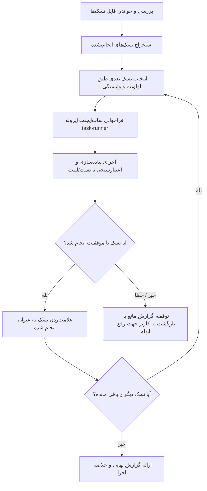

# Spec Runner Skill (`/spec-runner`)

اجرای ترتیبی و گام‌به‌گام تسک‌های مشخص‌شده در اسناد Spec یا آرگومان‌های ورودی با استفاده از ساب‌ایجنت‌های ایزوله (`task-runner`).

## آرگومان‌ها و نحوه اجرا (Arguments & Execution)
- **آرگومان ورودی:** مسیر فایل تسک‌های ویژگی (مانند `specs/001-feature/tasks.md` یا `services/.../tasks.md`) یا لیست تسک‌های مورد نظر برای اجرا (ارائه‌شده در اسلش‌کامند یا پیام چت).
- در صورت دریافت ورودی، بلافاصله فایل یا تسک‌های مشخص‌شده را مطالعه کرده و فرآیند اجرای ترتیبی را آغاز کنید.

## گردش کار اجرا (Execution Workflow)

1. **بررسی سند تسک‌ها (Read Spec File):** فایل تسک‌های مشخص‌شده را خوانده و فهرست تسک‌های باقیمانده (`- [ ]`) را استخراج کنید.
2. **ترتیب‌بندی تسک‌ها (Sequence Tasks):** تسک‌های انجام‌نشده را بر اساس فازها و وابستگی‌ها مرتب کنید.
3. **اجرای گام‌به‌گام با ساب‌ایجنت (Sequential Execution via Subagents):**
   - برای هر تسک به صورت مستقل یک ساب‌ایجنت ایزوله اجرا کنید تا کانتکست سشن اصلی شلوغ نشود.
   - **پیکربندی ساب‌ایجنت:**
     - **در Google Antigravity:**
       - با استفاده از ابزار `define_subagent` (در صورت تعریف نبودن) ساب‌ایجنت با نام `task-runner` و با مشخصات [references/task-runner.md](./references/task-runner.md) ثبت شود.
       - سپس با ابزار `invoke_subagent` با نقش `Task Runner`، ساب‌ایجنت فراخوانی شود.
     - **در Kilo Code و سایر محیط‌ها:**
       - از ابزار ساب‌ایجنت (مانند `task(subagent_type="task-runner", prompt=...)`) استفاده شود.
   - **محتوای ارسالی به ساب‌ایجنت:** شرح کامل تسک، الزامات، کانتکست و مسیر دقیق فایل‌های هدف را مستقیماً به پرامپت ساب‌ایجنت منتقل کنید.
   - منتظر پایان کار ساب‌ایجنت بمانید و نتیجه را اعتبارسنجی کنید (اجرای تست یا لینت). تا زمان تکمیل و تایید تسک جاری، به سراغ تسک بعدی نروید.
   - پس از تأیید، وضعیت تسک در فایل تسک‌ها را به `[x]` تغییر دهید.
4. **گزارش نهایی (Summary Report):** خلاصه ساختاریافته از وضعیت تمام تسک‌های اجرا شده، فایل‌های ایجاد/ویرایش‌شده و نتایج بررسی‌ها ارائه دهید.
